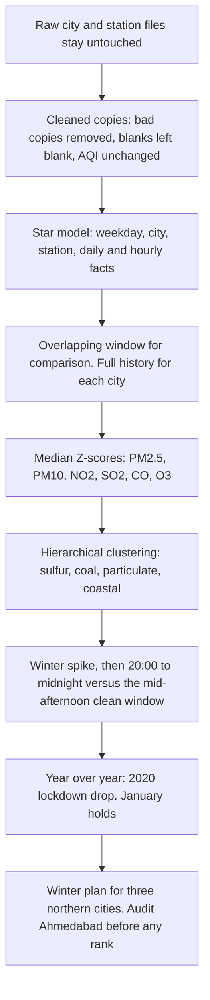

# Urban Air Quality Intelligence: India 2015–2020

India’s air is not one crisis. Cities are grouped by the pollutant that is actually high, by the hour and the season, and by whether 2020 changed the winter.



## Key Analytical Pillars

1. **Data cleaning and modelling**
   - Accounted for staggered sensor start dates so a late city is not treated as a clean city.
   - Used one overlapping window for cross-city comparison, and each city’s full history for the year-over-year baseline.
2. **Global Z-score profiling and clustering**
   - Standardized PM₂.₅, PM₁₀, NO₂, SO₂, CO, and O₃, then took each city’s median Z-score.
   - Hierarchical clustering heatmap, four behavioral archetypes: Industrial Sulfur Hubs, Coal and Mining Belts, Particulate Megacities, and Clean Coastal Hubs. Nitrogen dioxide rises inside the sulfur and particulate groups.
3. **Temporal and diurnal waves**
   - Northern winter repeats: high in November–January, low in the monsoon.
   - Late-evening double-whammy from 20:00 to midnight. Mid-afternoon is the clean window.
4. **Longitudinal progress tracking**
   - Year-over-year monthly medians. April–June 2020 drops with the lockdown. January does not fall to that level.

## Decision

| Group | January AQI | Action |
| --- | ---: | --- |
| Particulate megacities | 356 | Winter plan, 9 PM through the next morning |
| Industrial sulfur and coal | 307 | Audit Ahmedabad. Patna joins the winter plan |
| Clean coastal hubs | 126 | Protect the baseline |

## Run

```bash
pip install -r requirements.txt
streamlit run app.py
```

Place `city_day.csv` and `city_hour.csv` in `cleaned files/` next to `app.py`. The page opens on the shared window. The decision block sits under the charts.

2020 ends 1 July. A month is drawn only with 20 or more measured days.
