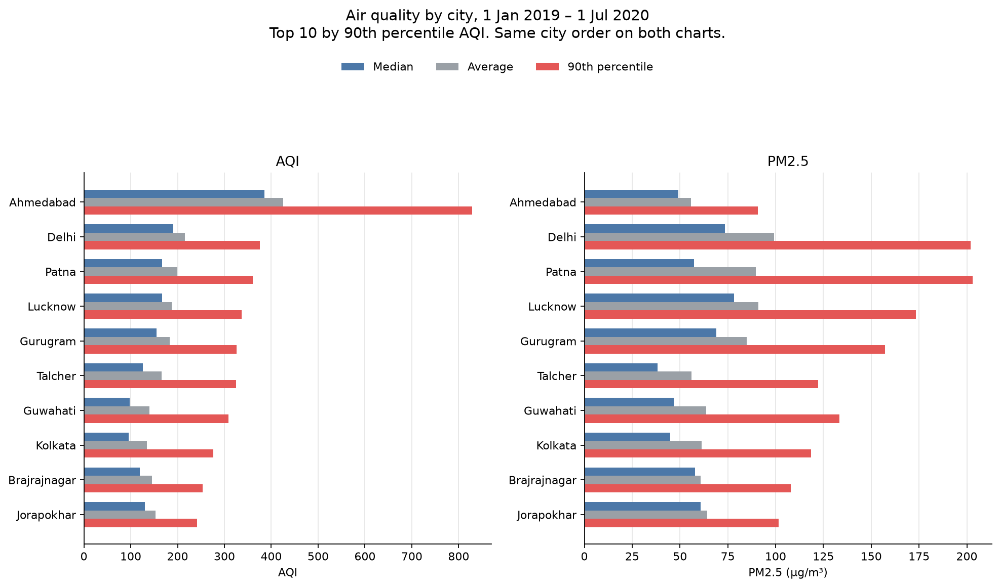
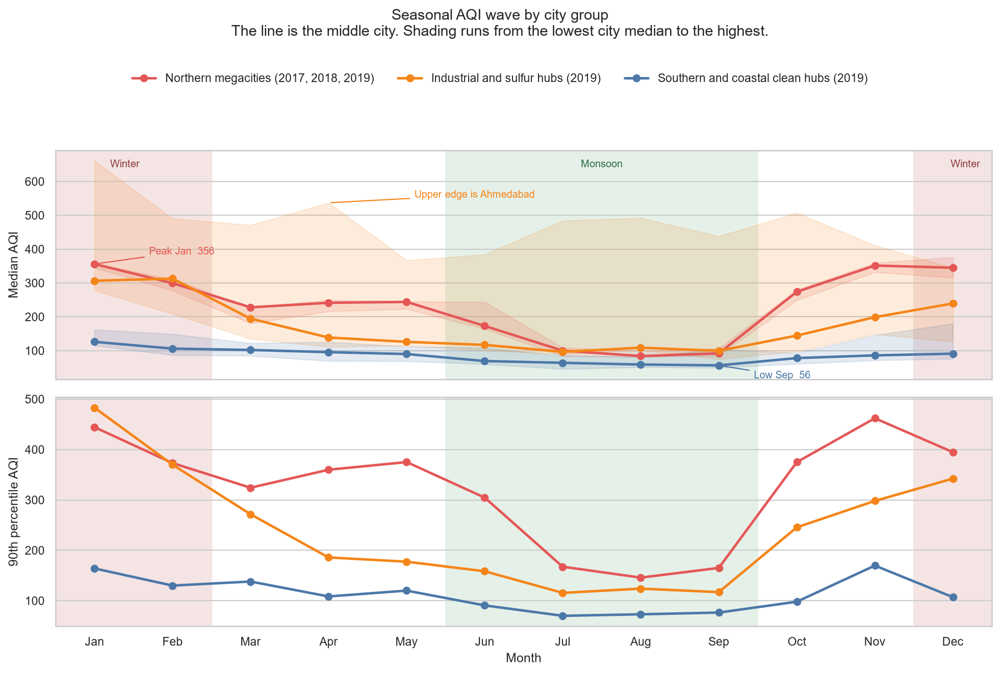
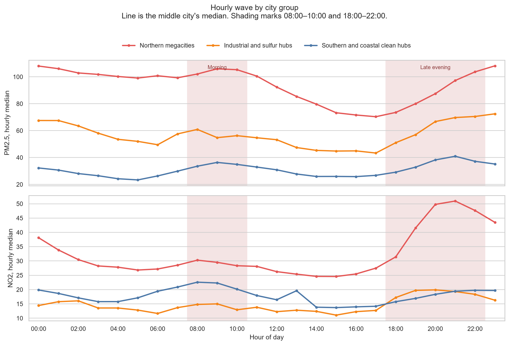
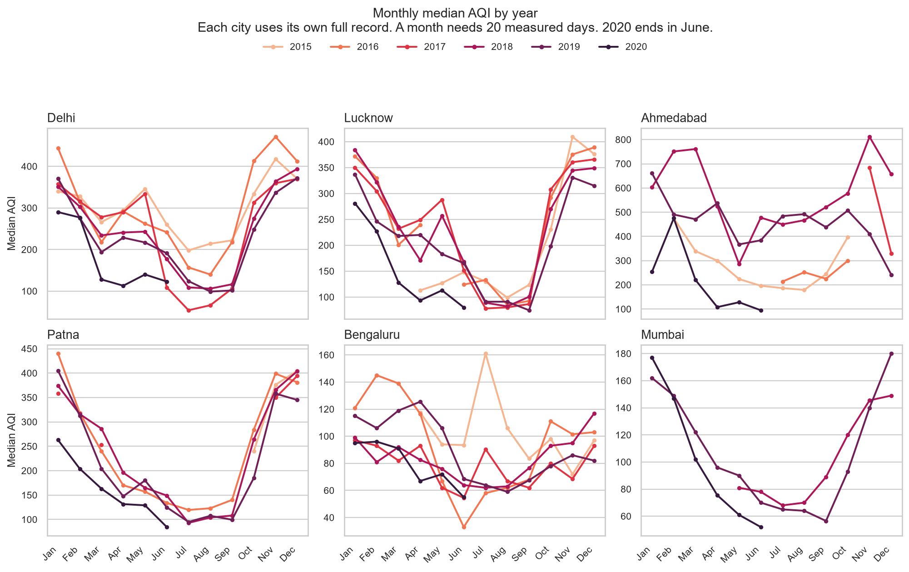

# Air quality brief

Daily and hourly city records, 1 January 2015 – 1 July 2020. Figures below sit with the finding they support.

## 1. Executive summary

- The crisis is the northern winter, not a year-round national average. In Delhi, Lucknow, and Gurugram the typical winter day is about **350 AQI**. In August it is about **84**.
- The risk inside that season is fine particles from late evening through the next morning, and a nitrogen dioxide peak at **9 PM**. A rule that stops at 8 PM misses the peak.
- Ahmedabad posts the highest AQI in the set. Its fine particles do not. Do not use that AQI number in a ranking or a public alert until the monitor is checked.
- **Primary move:** one winter plan for Delhi, Lucknow, and Gurugram, covering 9 PM through mid-morning. A weekend traffic ban is the wrong first lever. Saturday and Sunday differ from weekdays by only a few points.

## 2. Data and how cities were compared

- **26 cities**, daily and hourly, from the cleaned city files. The raw files were not overwritten.
- A blank cell was left blank. A recorded zero was kept as a real reading. Known bad copies were removed before any ranking.
- A fair cross-city rank uses **1 January 2019 – 1 July 2020**, and only cities with at least a year of both AQI and fine particles. Seven late-joining cities were left out of that rank.
- Group trends use only full calendar years every member was already recording: **2017–2019** for the northern cities, **2019** for the industrial and southern groups. 2020 stops on 1 July, so it is never treated as a full year.
- Each city counts once. One extreme monitor cannot set the group line. Dust and gases were put on one scale before cities were grouped.

### Data issues found

- **Ahmedabad carbon monoxide** was a copy of another gas and was removed. There is no usable carbon monoxide series for that city.
- **Ahmedabad AQI** stays in the Severe range while fine particles stay moderate. The two measures disagree.
- **Lucknow** has no coarse-particle (PM10) record. **Patna’s** coarse-particle record starts only in late 2019.
- **Hyderabad** shows gas spikes at the same early-afternoon hour for years. Treat that as an instrument pattern, not as the city’s true afternoon pollution.
- AQI in the daily file is the average of that day’s hourly AQI readings. It was not rebuilt from the pollutant columns, and it should not be.
- Aizawl, Kochi, Ernakulam, Shillong, Bhopal, Chandigarh, and Coimbatore joined too late for a fair full-year comparison.

## 3. What the city groups do

Cities were grouped by which pollutant is actually high, not by map location. Patna is in the north and behaves like an industrial city. Amritsar is in the north and is comparatively clean, so it is not in the northern group.

- **Northern megacities — Delhi, Lucknow, Gurugram.** Fine particles drive the day. In the 2019–mid-2020 window their bad day (the high end, not the typical day) is about **330–380 AQI**. Winter is the severe season. Particle spikes are common and still do not look “unusual,” because the ordinary day is already bad.
- **Industrial and sulfur hubs — Ahmedabad, Patna, Talcher, Brajrajnagar, Jorapokhar.** Ahmedabad is the AQI outlier and the data risk. Patna’s winters match the northern particle cities (January 2019 fine particles were higher than Delhi’s). Talcher and Brajrajnagar are high on carbon monoxide, low on nitrogen dioxide, and very low on ozone: a combustion-town pattern, not a traffic pattern.
- **Southern and coastal hubs — Bengaluru, Chennai, Mumbai, Hyderabad, Thiruvananthapuram.** The typical winter day is about **126 AQI**. The cleanest month is about **56**. Their nitrogen dioxide bump is at **8 AM**, and it is far smaller than the northern 9 PM peak.

## 4. When it happens

- **Worst months:** November, December, January. **Safest months:** July, August, September.
- **Safest hours:** mid-afternoon. Northern fine particles bottom out then, near 70, after sitting near **100–110** from late evening through mid-morning.
- **Sharpest clock-hour spike:** northern nitrogen dioxide at **9 PM**, about double the midday level (51 against 25). The 8 AM bump only reaches about 30.
- Hourly AQI barely moves (about 228 to 238 in the north). Time-of-day decisions should use fine particles and nitrogen dioxide, not AQI.
- **2020 shows that cutting activity clears the air within weeks.** April–June AQI versus 2019: Delhi **217 → 123**, Lucknow **183 → 94**, Mumbai **90 → 61**, Bengaluru **106 → 67**. January 2020, before the lockdown, was already lower than January 2019 in Delhi, Lucknow, and Patna, and **higher** in Mumbai. The shutdown did not, by itself, set the next winter. Patna’s spring barely moved (**148 → 129**). Ahmedabad’s AQI also collapsed, including in January, while its fine particles moved much less.

## 5. Recommended next steps

| Focus area | Recommended action | Target timeline |
|---|---|---|
| Delhi, Lucknow, Gurugram | Winter controls from 9 PM through the next morning, aimed at fine particles and the 9 PM nitrogen dioxide peak | Plan ready in October. In force November–January |
| Ahmedabad | Check the AQI monitor before any ranking, target, or public alert | Within 30 days |
| Patna; Talcher and Brajrajnagar | Patna: treat winter particles like the northern cities. Coal towns: review sources that run all week. Carbon monoxide there does not fall on weekends | This quarter |
| All cities | Do not lead with a weekend ban or a weekday-only driving rule. The weekend gap is a few AQI points against a winter gap of roughly 270 | Not the primary lever |
| Data for the next review | Fill the leadership pack without Lucknow PM10 or Ahmedabad carbon monoxide presented as real series. Do not recalculate AQI from the other columns | Before the next quarterly review |
